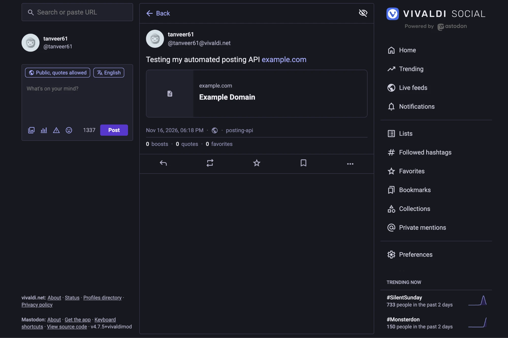
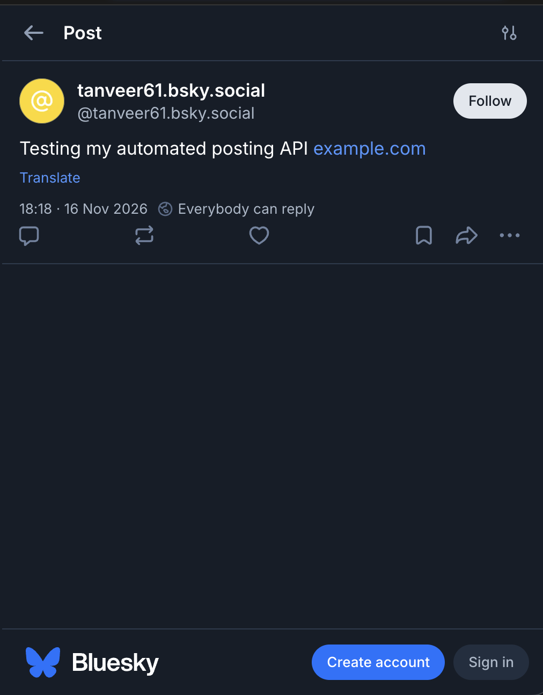
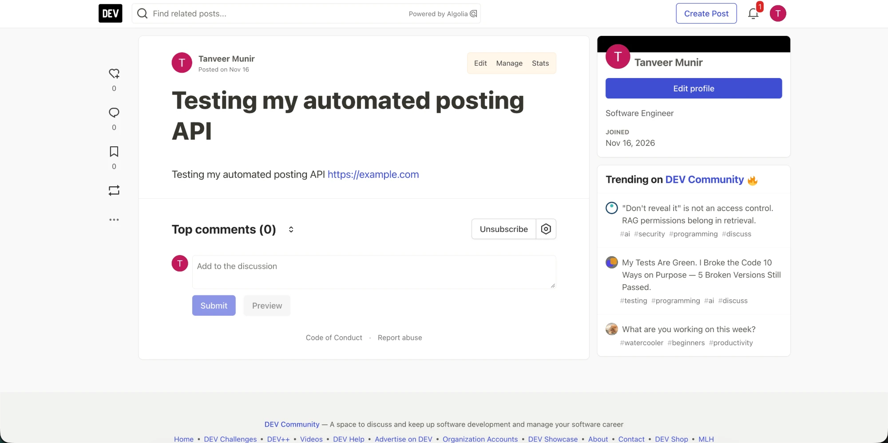
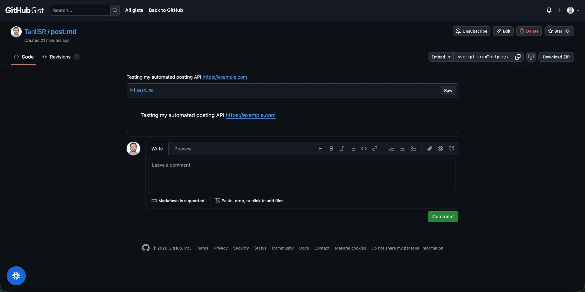
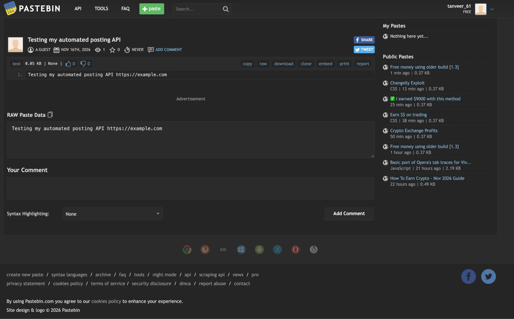

# Automated Multi-Platform Posting

A FastAPI service that takes one short message with a call-to-action (CTA) link and publishes it to six platforms at the same time. If one platform fails, the others still post, and the response reports the outcome per platform.

## Platforms

| Platform | API used | Credentials needed |
|---|---|---|
| **Telegraph** | `api.telegra.ph` `createAccount` / `createPage` | None (an anonymous account is created automatically) |
| **Mastodon** | `POST /api/v1/statuses` | Access token with `write:statuses` |
| **Bluesky** | AT Protocol `createSession` / `createRecord` | Handle and app password |
| **Dev.to** | `POST /api/articles` | API key |
| **GitHub Gist** | `POST /gists` (public gist) | Token with the `gist` scope |
| **Pastebin** | `POST /api/api_post.php` (public paste) | API dev key |

A platform with no credentials is reported as `failed` with a "Missing credentials" error. The rest still run, so the service works with any subset configured. Telegraph needs no credentials at all.

No LLM platform is included: the major LLM providers expose no public API for publishing a post, only for generating text.

## Setup

Requires Python 3.10 or newer.

```bash
python3 -m venv .venv
source .venv/bin/activate
pip install -r requirements.txt
cp .env.example .env
```

Fill in the values you have in `.env`. Never commit `.env`; it is listed in `.gitignore`.

### Getting credentials

| Variable | Where to get it |
|---|---|
| `TELEGRAPH_TOKEN` | Optional. Leave empty to use a new anonymous account on every request. |
| `MASTODON_INSTANCE` | Your server, default `https://mastodon.social`. |
| `MASTODON_ACCESS_TOKEN` | Preferences, Development, New application. Tick `write:statuses`, then copy "Your access token". |
| `BLUESKY_HANDLE` | Your handle, for example `you.bsky.social`. |
| `BLUESKY_APP_PASSWORD` | Settings, Privacy and security, App passwords. Use an app password, not your account password. |
| `DEVTO_API_KEY` | Settings, Extensions, Generate API key. |
| `GITHUB_TOKEN` | Settings, Developer settings, Personal access tokens. Give it the `gist` scope only. |
| `PASTEBIN_API_KEY` | Log in to Pastebin and open https://pastebin.com/doc_api. Your "API Development Key" is shown there. |
| `REQUEST_TIMEOUT` | Seconds to wait for each platform. Default 20. |

## Run

```bash
uvicorn app.main:app --host 0.0.0.0 --port 4000
```

Interactive API documentation: http://localhost:4000/docs

## API

`POST http://localhost:4000/posting`

### Request

```json
{
  "message": "Check out our latest business platform and grow your online visibility. https://example.com"
}
```

```bash
curl -X POST http://localhost:4000/posting \
  -H "Content-Type: application/json" \
  -d '{"message": "Check out our latest business platform and grow your online visibility. https://example.com"}'
```

### Validation rules

- The message must not be empty.
- The message must not exceed 200 characters.
- The message must contain exactly one link.
- The link must be a full `http://` or `https://` URL with a real domain.

### Response (200)

The status code is 200 whenever the request was valid, even if some or all platforms failed. Look at each result for the outcome. `success` is `true` when at least one platform posted.

Real output from a live run (see [Live results](#live-results)):

```json
{
  "success": true,
  "results": [
    {
      "platform": "Telegraph",
      "status": "failed",
      "posted_url": null,
      "public_access": false,
      "date": null,
      "time": null,
      "error": "ConnectTimeout"
    },
    {
      "platform": "Mastodon",
      "status": "success",
      "posted_url": "https://social.vivaldi.net/@tanveer61/117626314997348417",
      "public_access": true,
      "date": "2026-11-16",
      "time": "18:18:48",
      "error": null
    },
    {
      "platform": "Bluesky",
      "status": "success",
      "posted_url": "https://bsky.app/profile/did:plc:r6oejzxyppstbr45ow23tdcv/post/3n2gmj6y6c72p",
      "public_access": true,
      "date": "2026-11-16",
      "time": "18:18:49",
      "error": null
    },
    {
      "platform": "Dev.to",
      "status": "success",
      "posted_url": "https://dev.to/tanveer_munir/testing-my-automated-posting-api-375l",
      "public_access": true,
      "date": "2026-11-16",
      "time": "18:18:48",
      "error": null
    },
    {
      "platform": "GitHub Gist",
      "status": "success",
      "posted_url": "https://gist.github.com/TaniiSR/421ff4f3419b074b60b9bf252f7a4fa7",
      "public_access": true,
      "date": "2026-11-16",
      "time": "18:18:49",
      "error": null
    },
    {
      "platform": "Pastebin",
      "status": "success",
      "posted_url": "https://pastebin.com/vVQED4X0",
      "public_access": true,
      "date": "2026-11-16",
      "time": "18:34:35",
      "error": null
    }
  ]
}
```

| Field | Meaning |
|---|---|
| `platform` | Platform name |
| `status` | `success` or `failed` |
| `posted_url` | Link to the published post, `null` on failure |
| `public_access` | `true` if a GET request to `posted_url` returns 200 |
| `date`, `time` | When the post was made, `null` on failure |
| `error` | What went wrong, `null` on success |

### Validation error (422)

```bash
curl -X POST http://localhost:4000/posting \
  -H "Content-Type: application/json" \
  -d '{"message": "No link in this message"}'
```

```json
{
  "success": false,
  "errors": [
    {
      "field": "message",
      "message": "Message must contain exactly one CTA link (found 0)."
    }
  ]
}
```

## Live results

The service was run against the real platforms with the message `Testing my automated posting API https://example.com`. The full JSON output is shown under [Response (200)](#response-200), and is also saved in [`docs/live-results.json`](docs/live-results.json). The server log is below and in [`docs/server.log`](docs/server.log).

| Platform | Status | Public | Posted URL |
|---|---|---|---|
| Mastodon (Vivaldi Social) | Success | Yes | https://social.vivaldi.net/@tanveer61/117626314997348417 |
| Bluesky | Success | Yes | https://bsky.app/profile/did:plc:r6oejzxyppstbr45ow23tdcv/post/3n2gmj6y6c72p |
| Dev.to | Success | Yes | https://dev.to/tanveer_munir/testing-my-automated-posting-api-375l |
| GitHub Gist | Success | Yes | https://gist.github.com/TaniiSR/421ff4f3419b074b60b9bf252f7a4fa7 |
| Pastebin | Success | Yes | https://pastebin.com/vVQED4X0 |
| Telegraph | Failed | No | `ConnectTimeout`: the test network could not reach `api.telegra.ph` |

### Screenshots

Each post as it appears on the platform.

**Mastodon (Vivaldi Social)**



**Bluesky**



**Dev.to**



**GitHub Gist**



**Pastebin**



### Server log

Log from the run above (`docs/server.log`). The single `POST /posting` request returned 200:

```
INFO:     Started server process [17622]
INFO:     Waiting for application startup.
INFO:     Application startup complete.
INFO:     Uvicorn running on http://0.0.0.0:4000 (Press CTRL+C to quit)
INFO:     127.0.0.1:50355 - "GET /docs HTTP/1.1" 200 OK
INFO:     127.0.0.1:50357 - "POST /posting HTTP/1.1" 200 OK
INFO:     Shutting down
INFO:     Waiting for application shutdown.
INFO:     Application shutdown complete.
INFO:     Finished server process [17622]
```

Five platforms published successfully. Telegraph failed only because the network used for the test blocks Telegraph and Telegram, and the service reported that failure without stopping the other platforms.

Two platforms were tried and replaced during development. Write.as accepted the request but replaced the post with its "Blocked Post" placeholder, which the service now reports as a failure. Hashnode retired its free API. Pastebin was added in their place, and its result comes from a second run made after the swap.

## Tests

```bash
pytest
```

The tests use fake HTTP transports, so they need no network and no credentials. The project was built test-first.

## Project structure

```
app/
  main.py                  FastAPI app and POST /posting
  schemas.py               Request validation and response models
  config.py                Reads settings from the environment
  platforms/
    base.py                Platform interface and shared error handling
    registry.py            The list of platforms used by the app
    telegraph.py  mastodon.py  bluesky.py  devto.py  gist.py  pastebin.py
  services/
    posting_service.py     Runs all platforms concurrently and collects results
tests/                     One test file per module, plus end-to-end tests
.env.example               Template for credentials (no real secrets)
```

## Design notes

- **Concurrent posting.** All platforms run at once with `asyncio.gather`, so total time is about the slowest platform, not the sum.
- **Independent failures.** Every platform's exception is caught and turned into a `failed` result. One failure never stops the others.
- **Real public check.** `public_access` comes from fetching the posted URL, not from assuming it.
- **Adding a platform.** Create a class in `app/platforms/` that extends `Platform`, then add it to `all_platforms()` in `registry.py`.
